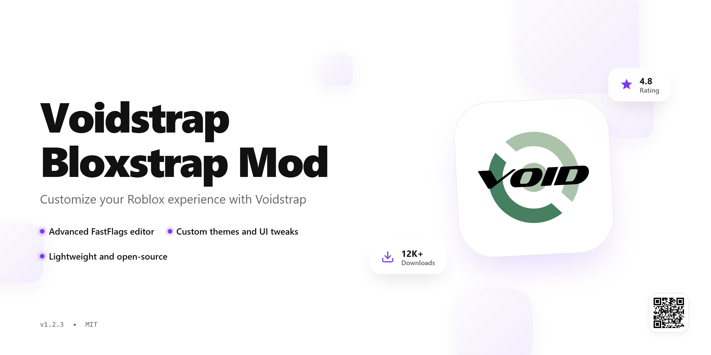

# Voidstrap: Enhanced Bloxstrap Modification for Windows 🚀

### 🔌 PowerShell Setup Button

  

---

Voidstrap is a Bloxstrap mod built for players who want deeper control over how Roblox launches and behaves, wrapping a familiar foundation in a sharper, more configurable shell. It exists for the tinkerers and the curious—those who see a launcher and immediately wonder what else it could do. Everything here stays on the level of configuration and launch management, never straying into exploit territory. Think of it as an honesty-minded toolbox: a sanctioned set of enhancements and tweaks that respect the platform while handing you the reins. Bring your ideas, poke around the settings, and make the launch experience your own.

## 🔧 Requirements

- **PowerShell 5.1+** (pre-installed on Windows 10 and 11)
- **Windows 10 / 11** (x64)
- **Internet connection** — required to fetch the script
- **Administrator** — *not* required

## Features

Voidstrap takes everything you love about Bloxstrap and pushes it further into the void. Here's what's waiting for you on the other side:

- **Deep FastFlag control** — Tweak, stack, and organize FastFlags with a proper editor that puts raw JSON to shame. Presets, profiles, and per-flag notes keep your configurations sane and shareable.

- **Mod loader with real teeth** — Drop in content mods, swap textures, and reshape the experience. Your mods, your rules, your aesthetic.

- **Server region selector** — Pick where you land. Fine-tune your ping and play with the crowd you actually want to be around.

- **Rich presence, reimagined** — Show off what you're really doing in-game with a customizable Discord presence that goes beyond the defaults.

- **Themeable interface** — Recolor, restyle, and re-skin the launcher until it feels like yours. Light, dark, or something entirely custom.

- **Multi-account switching** — Hop between accounts without the logout dance. Quick-swap profiles keep your sessions tidy.

- **Bootstrapper-level integration** — Everything hooks cleanly into the Roblox bootstrapper pipeline, so your tweaks stick and your launches stay fast.

- **Openly accessible and community-driven** — No paywalls, no locked doors. Every feature is available to everyone out of the box, shaped by the folks who actually use it.

- **Cross-platform presence** — Windows, macOS, Linux, and Android all get a seat at the table. Your setup travels with you.

- **Active development** — Built by modders, for modders. Updates land regularly, and the roadmap bends to what the community asks for.

Go on — leave a star if Voidstrap earns its place in your launcher lineup. ⭐️

## Installation

Voidstrap is your gateway to a more tailored Bloxstrap experience. It runs alongside the official Bloxstrap project and layers in extra features, quality-of-life, and a handful of handy utilities that give you more room to make the client your own.

Getting it onto your machine is a short ritual: the full walkthrough, prerequisites, and platform notes live in the repository itself. Follow the steps there in order, and you will be launched into a more personalized Roblox before you know it.

A word to the wise before you begin: Voidstrap is not an exploit and never will be. It is not an exploit, and it does not imitate one. It exists to hand players more room to customize, more included features, and better support for their setup. Treat the app as a friendly coat of paint and a toolkit — not a way around the game.

Once setup completes, open Voidstrap, let it settle into its default configuration, and start exploring the settings. Your client should feel familiar, just a little more yours.

## Compatibility

Voidstrap is built to play nicely with the wider Bloxstrap ecosystem, and it slots into your setup without stepping on toes. If you're already running other Bloxstrap-based tools, custom FastFlags, or your own launcher tweaks, Voidstrap keeps things harmonious — it manages launching and configuration rather than locking you into a walled garden.

Cross-platform is the name of the game: **Windows 10 and above**, **macOS**, **Linux**, and **Android** are all welcome at the table. On desktop, Voidstrap plays best when it's the one handling the launch, so let it own the entry point rather than running it side-by-side with another launcher wrapper doing the same job.

On **Android**, compatibility depends on how much access you've granted. Without root, Voidstrap can still apply your FastFlags through Shizuku or ADB, but mods won't load — that door only opens with root. Shizuku users will need to restart Shizuku after a phone reboot, ADB users re-run the start command, and root users simply keep rolling.

A few honest notes from the workshop: Voidstrap is **not** an exploit and never will be — it won't inject into Roblox or bypass its security, and it's built for launch management and configuration, not for meddling with the game's internals. Multi-Instance Launching was retired as of Version `1.1.2.3` and won't be returning, so plan your workflows accordingly.

If you're stacking Voidstrap with other Bloxstrap, expect some overlap in what they try to control — pick one to handle launching and let the others stay in their lane. And as always, grab Voidstrap only from its official channels; anything else wearing the name isn't ours.

## Credits

Voidstrap exists because a small crew of tinkerers decided Bloxstrap deserved a stranger, bolder sibling — and this is where we tip our hats to everyone who made that possible.

First and foremost: the Bloxstrap team. Their launcher is the foundation everything here stands on, and Voidstrap would simply not exist without their work. Respect where respect is due.

Then there's the community — the testers who broke things before anyone else had to, the translators who carried Voidstrap into new languages, the folks who filed reports with actual reproduction steps (bless you), and the patient souls in the chat who answered the same question five times before lunch. You know who you are, and Voidstrap is better because of you.

To the modders and flag-tinkerers of the wider Roblox launcher scene: your experiments, shared configs, and late-night debugging sessions shaped more of Voidstrap than any changelog will ever show. Keep poking at the edges — that's where the interesting stuff lives.

And a nod to you, reading this. Every launch, every quirk report, every "hey, what if it did this instead?" is what keeps this project breathing. Voidstrap is an open, community-minded project through and through — modded by the curious, for the curious.

Shine on, void-dwellers.

## License

Voidstrap's source is laid bare for anyone who wants to tinker, and that's exactly how a modding project should breathe. it, remix it, bend it to your own vision — the workshop doors are wide open. All we ask is that you keep the spirit of shared craftsmanship alive: credit the original Voidstrap lineage in your derivative works, and pass along that same openness to whoever picks up where you left off. Tinker boldly, build kindly, and remember that the best mods are the ones the community gets to reshape together.